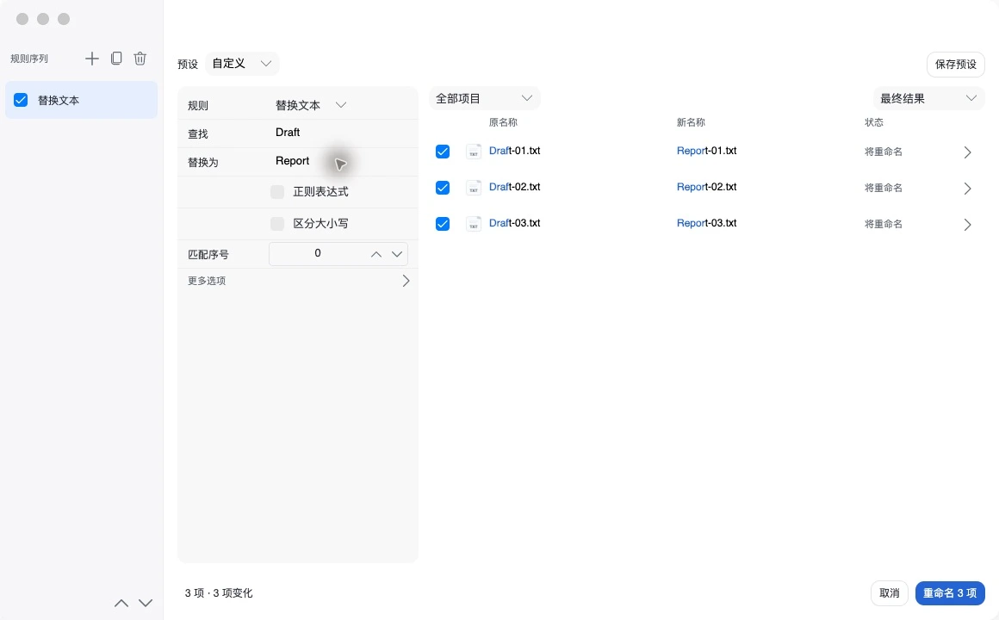
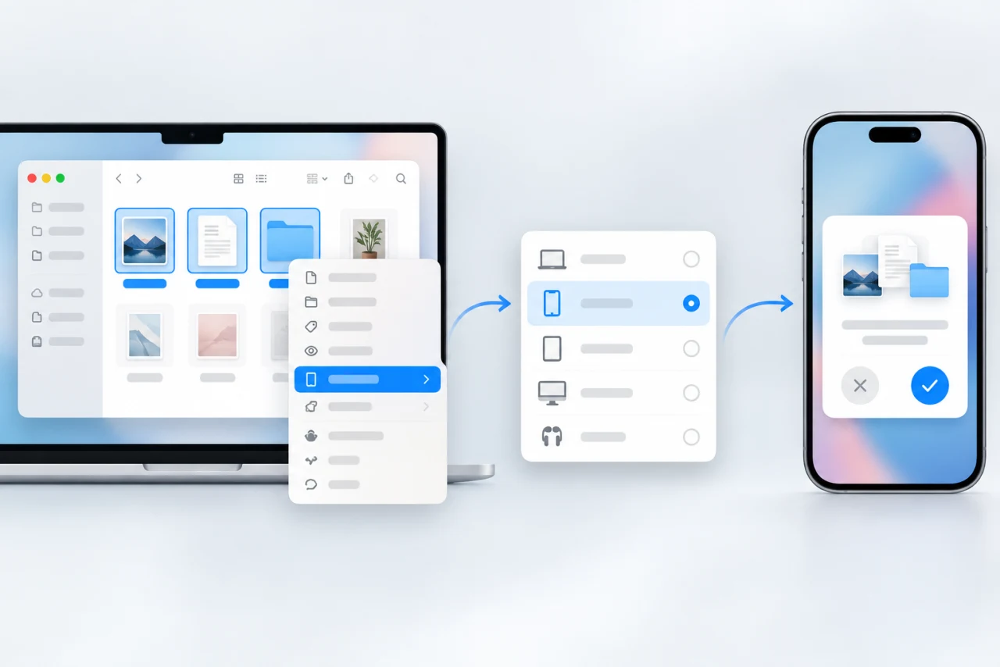
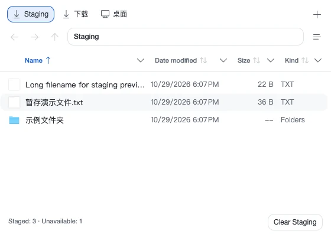
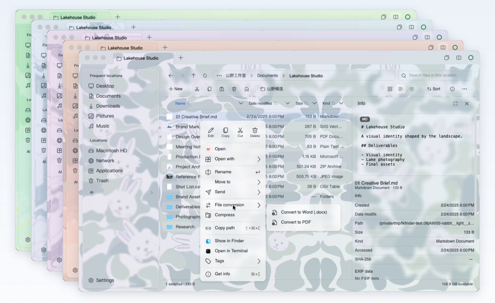

<a href="README.md">简体中文</a> · <strong>English</strong>

  

<h1 align="center">Mac Explorer</h1>

A file workspace for macOS — browse, search, preview, organize, and share in one window.

  
  
  
  

  <a href="https://macexplorer.top/">Website</a> ·
  <a href="https://github.com/3egirlsdream/Mac-Explorer/releases/latest">Download</a> ·
  <a href="CHANGELOG.md">Changelog</a> ·
  <a href="https://macexplorer.top/privacy/">Privacy</a> ·
  <a href="https://github.com/3egirlsdream/Mac-Explorer/issues">Feedback</a>

Finding Finder a bit cramped? Mac Explorer brings split panes, instant previews, full-text and image OCR search, batch renaming, and remote/LAN file transfers into a single macOS workspace. It is a standalone app that **never modifies or replaces Finder**, so you can try it alongside Finder without affecting your files.

Tab groups and split panes: list view on one side, icon grid on the other, without juggling windows.

## Performance vs Finder

Measured across 8 everyday benchmarks comparing Mac Explorer 2.0.3 against macOS Finder (Apple M5 · 32 GB):

- **Faster on large folders**: 0.10 s for 1,000 files (Finder: 0.93 s), and 0.59 s for 100,000 files (Finder: 1.69 s).
- **Near-instant Space preview**: 0.09 s for a 12 MP JPEG and 0.07 s for a 20-page PDF (Finder: ~0.5–0.6 s).
- **Lower memory footprint**: 727 MiB physical footprint after organizing tasks, nearly half of Finder's 1,279 MiB.

## Features

### 1. Multi-Folder Workspace: Split Panes, Groups & Workbench

- **Split panes and tab groups**: Work across 2 to 4 panes (or a main-plus-side layout) with top tabs or a hover-to-expand **vertical tab bar**. Group related folders by project and save presets to restore an entire layout in one click.
- **Four views, instant filtering**: Switch between list, icon grid, tree list, and gallery views. Narrow large folders quickly with grouping, multi-column filters, and type-to-jump navigation.
- **Workbench & organization without moving files**: Start from a Workbench showing disks, tab groups, frequent folders, and recent files. Collect scattered items with nested tags, favorites, and star ratings while leaving source files where they are.
- **File details & disk management**: Check camera EXIF metadata or copy a local file's SHA-256 hash in the info panel, and open Disk Management right from the sidebar to check mounted volumes and eject drives.

### 2. Find Fast, See Clearly: Global Search & Instant Preview

Press <code>⌘ K</code> for global search with live side-by-side preview — no need to open another app first.

- **Search names and contents with `⌘ K`**: Find indexed filenames, PDF text, and OCR text inside images. Preview any selected result right beside the list or jump straight to its folder.
- **On-device photo analysis**: Browse photos by people, recognized text, scenes, dates, and places, and name people groups — all analyzed locally on your Mac.
- **Preview in place with `Space`**: Inspect images, PDFs, Office documents, native video, folders, and nested archives without leaving the window. Edit Markdown with live rendering and compare code changes with a side-by-side Diff view.

### 3. Clean Up Effortlessly: Batch Rename, Archives & Conversion

Batch rename workbench: stack rules on the left and inspect every filename diff before applying.

- **Batch rename workbench**: Rename local files and folders across directories by combining replace, regex, numbering, date, case, cleanup, and template rules. Preview every diff, catch name conflicts upfront, save presets, and undo an entire batch if needed.
- **Browse archives like folders**: Double-click ZIP, TAR, or 7Z archives to inspect contents and extract just the single file you need, or create password-protected ZIP, TAR.GZ, and TAR.BZ2 archives.
- **Right-click file conversion**: Convert Markdown, text, or Word documents to PDF or Word, and batch-convert SVG, WebP, ICO, or ICNS images to PNG or JPG at custom sizes.
- **Controllable background tasks**: Copies, moves, and extractions run in a dedicated queue with pause and resume. When names collide, compare file sizes and timestamps side by side before choosing to skip, replace, or keep both.

### 4. Remote & Cross-Device: Servers, LocalSend & File Delivery

  

Send files or folders straight from the context menu to nearby phones and computers via LocalSend.

- **Local and remote in one place**: Built-in SFTP client (password, private key, and fingerprint verification) that automatically uploads changes when you edit a remote file locally, plus macOS-mounted SMB and WebDAV with LAN server discovery.
- **Git-aware browsing**: See Git status badges beside repository files, and view diffs, commit history, or stage changes right from the context menu.
- **Quick LAN & Apple sharing**: Send files and folders via **LocalSend** (auto-discovery or direct IP, with incoming confirmation) or share anytime with **AirDrop**.
- **Menu bar File Delivery & Staging**: Pull down Downloads, Desktop, or custom folders from the macOS menu bar even when the main window is closed. Drop scattered files into **Staging** to preview them together and drag them out to chat, email, or web uploads.

  

Menu bar File Delivery & Staging: keep downloads, desktop, and staged files one click away.

### 5. Copilot File Assistant

- **Work with files in plain language**: Ask Copilot to find files by combining metadata/OCR/tag criteria, organize selections, draft batch-rename rules, convert formats, or summarize approved documents. Attach file or folder paths directly and reuse workflows with built-in or custom skills.
- **Always asks before acting**: Before changing files or sending document contents to a model, Copilot shows its plan for your approval. Rename proposals can also open straight in the batch-rename workbench for fine-tuning.
- Turn it on in **Settings → Copilot** using your own OpenAI-compatible API endpoint, model name, and API key (disabled by default).

### 6. Make It Yours: Themes, Shortcuts & Extensions

Nine built-in background themes with frosted glass surfaces, shown with the right-click conversion menu.

- **Themes & folder styles**: Enable **More themes** under **Settings → Appearance** to pick from nine tintable patterns or your own wallpaper with adjustable opacity, paired with light/dark frosted glass and Default, Frosted, Skeuomorphic, or photo-cover folders.
- **Localization, shortcuts & plugins**: Available in English, Simplified Chinese, Traditional Chinese, and French. Customize shortcuts with conflict checks and hold `⌘` for an on-screen cheat sheet. The website edition also supports the **plugin market**, local `.mexplug` packages (see the [plugin SDK](docs/plugins.md) and [developer center](https://macexplorer.top/developers/)), and custom Workbench scripts.

## Installation & Editions

Requires **macOS 14 or later** on **Apple Silicon or Intel**. Downloads bundle the runtime — no separate .NET installation is required.

1. Open the [latest release](https://github.com/3egirlsdream/Mac-Explorer/releases/latest).
2. Download the Apple Silicon DMG (`macos`) or Intel DMG (`macos-intel`) for your Mac (ZIP builds are also listed when available).
3. Open the DMG and drag **Mac Explorer** into **Applications**.

> This overview reflects the current source code. See the [changelog](CHANGELOG.md) for what is included in each published release.

| Area | Website edition (Free & Open Source) | App Store edition |
| --- | --- | --- |
| File access | Standard macOS file permissions | Authorize folders via the system picker; manage in Settings |
| Updates | In-app update checks and downloads | Managed through the App Store |
| Extensions & scripts | Plugin market, external plugins, scripts, and terminal actions | Built-in file conversion; no external plugins, arbitrary scripts, or terminal actions |
| Git status | Uses your installed system Git | Available when Git and the repository are within authorized scope; some setups unsupported |

## Default Shortcuts

| Shortcut | Action |
| --- | --- |
| `⌘ T` / `⌘ W` | New / close tab |
| `Control Tab` / `Control Shift Tab` | Next / previous tab |
| `⌘ L` | Focus the path bar |
| `⌘ F` | Search in the active folder |
| `⌘ K` / `⌘ Shift F` | Open global search |
| `Space` | Preview the selected file or folder |
| `Esc` | Close a preview or popup |
| `⌘ Z` | Undo a supported file operation |
| Hold `⌘` | Show shortcut hints (when enabled) |

Rebind supported commands anytime in **Settings → Shortcuts**.

## Privacy & Security

File indexes, tags, ratings, settings, image analysis results, and Copilot history stay local on your Mac, and image recognition runs on-device. External connections are only made when you opt into photo place-name lookup, configure your own AI provider, connect to a remote server, or transfer files with LocalSend.

Copilot asks for confirmation before sharing file details, sending file contents, or modifying files. For full transparency: saved Copilot API keys, SFTP passwords, and private-key passphrases are currently stored in the local application database without additional encryption. See the [privacy policy](https://macexplorer.top/privacy/) for full details.

## Development & Feedback

See the [build guide](doc/BUILD.md) for compiling, packaging, signing, and notarization, and [testing instructions](AGENTS.md#自动测试) for isolated app tests. To report a bug or suggest a feature, open a [GitHub Issue](https://github.com/3egirlsdream/Mac-Explorer/issues) with your macOS version, app version, and steps to reproduce.

## License

Mac Explorer is licensed under [GNU GPL v3.0 or later](LICENSE). Third-party notices are listed in [ThirdParty/Notices](ThirdParty/Notices/README.md).
