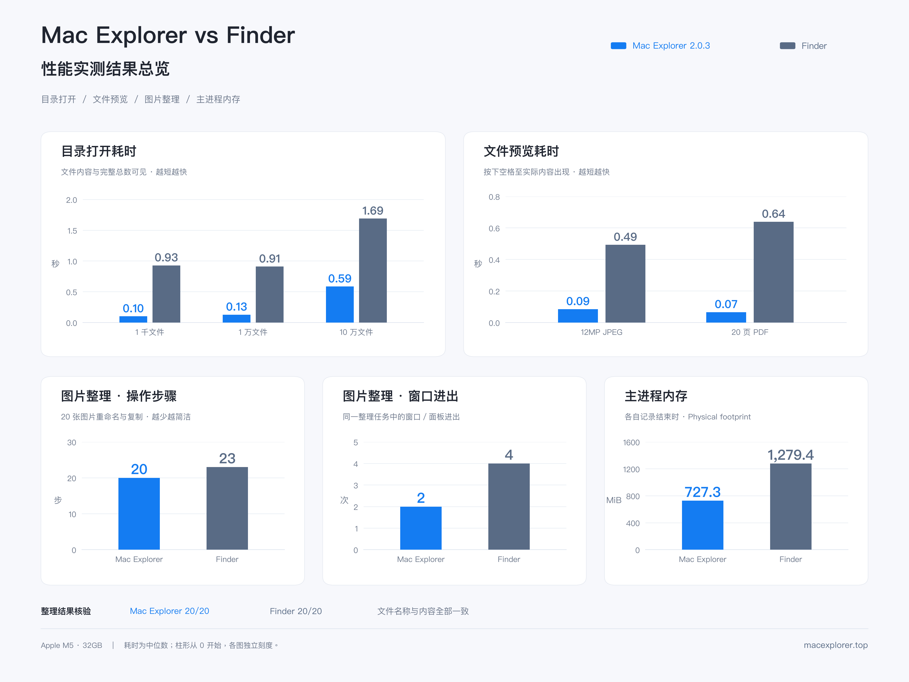
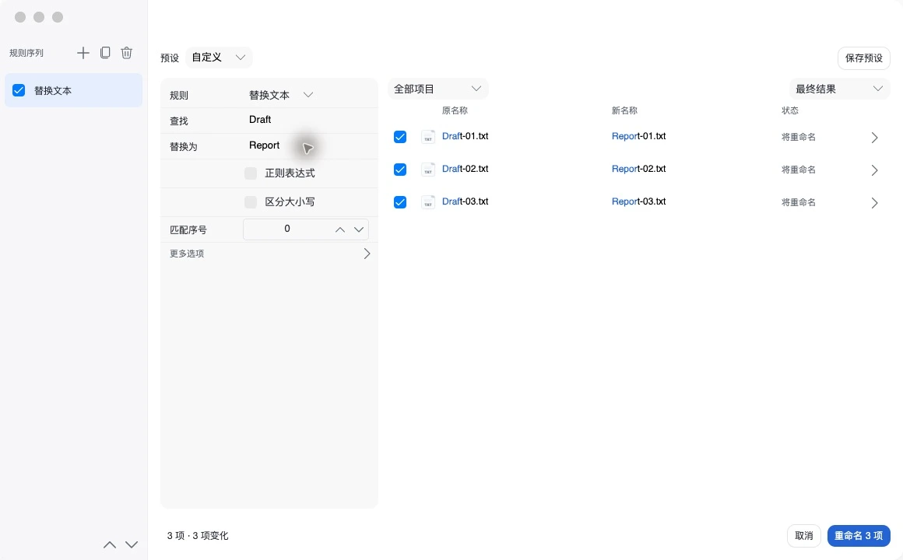
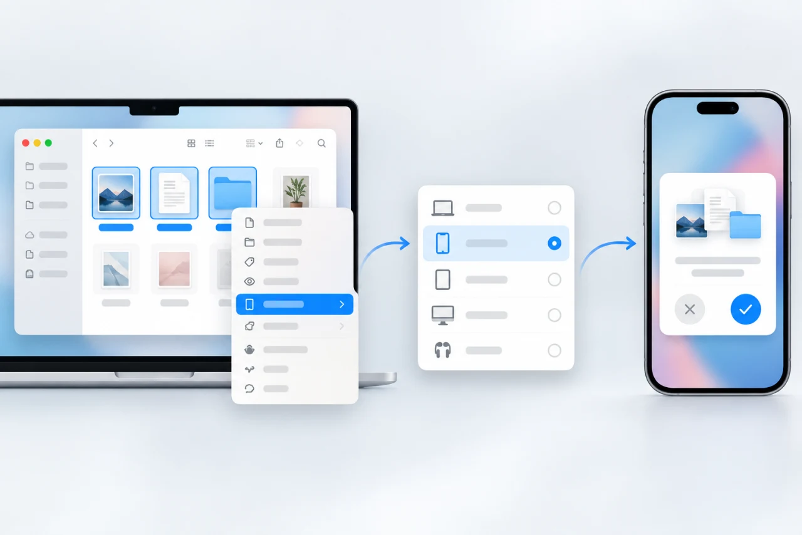
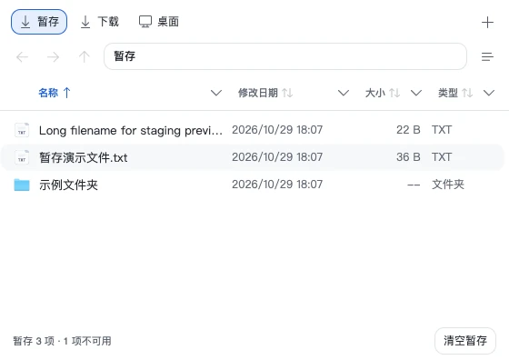
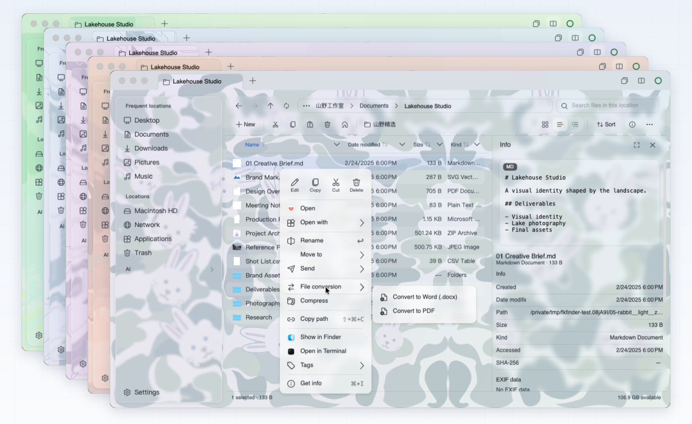

<strong>简体中文</strong> · <a href="README.en.md">English</a>

  

<h1 align="center">Mac Explorer</h1>

为 macOS 打造的文件工作台——浏览、搜索、预览、整理与传输，一个窗口搞定。

  
  
  
  

  <a href="https://macexplorer.top/">官网</a> ·
  <a href="https://github.com/3egirlsdream/Mac-Explorer/releases/latest">下载</a> ·
  <a href="CHANGELOG.md">更新日志</a> ·
  <a href="https://macexplorer.top/privacy/">隐私政策</a> ·
  <a href="https://github.com/3egirlsdream/Mac-Explorer/issues">反馈</a>

觉得系统自带的 Finder 不够好用？Mac Explorer 把日常找文件、看文件、批量整理和跨设备传文件收进同一个窗口，不用在十几个 Finder 窗口和零散小工具之间来回切。它是完全独立的应用，**不会修改或替换系统 Finder**，随时可以放心试用。

页签工作组与左右分屏：一边列表、一边图标网格，整理资料不用来回切窗口。

## 实测对比 Finder

光说快不算数，以下是 Mac Explorer 2.0.3 与 macOS Finder 的 8 项实测对比（Apple M5 · 32GB）：

- **大目录秒开**：1 千文件 0.10s（Finder 0.93s），10 万文件 0.59s（Finder 1.69s）。
- **空格预览更快**：12MP JPEG 仅 0.09s、20 页 PDF 仅 0.07s（Finder 约 0.5–0.6s）。
- **更省内存**：整理任务结束后主进程物理内存 727 MiB，几乎只有 Finder（1,279 MiB）的一半。

## 主要功能

### 1. 一窗多目录：分屏、工作组与工作台

- **多栏分屏与工作组**：支持双栏到四栏及主次分屏，搭配顶部页签或可悬停展开的**垂直页签栏**。按项目把相关目录收成工作组并存为预设，下次一键恢复整套布局。
- **四种视图与快速筛选**：列表、图标网格、树形展开、画廊四种视图自由切换，配合分组排序、多列筛选和键盘首字母定位，大目录也能迅速锁住目标。
- **工作台与不挪文件的归类**：在工作台一眼看到磁盘容量、工作组、常用目录与最近文件；用多级标签、收藏和星级把分散的资料归到一起，不用移动原文件。
- **文件细节与磁盘管理**：右侧信息面板直接看照片拍摄参数、一键算 SHA-256 校验值；从侧栏直达磁盘管理，查看外置卷容量并一键弹出。

### 2. 找得快、看得清：全局搜索与空格预览

按 <code>⌘ K</code> 唤出全局搜索，选中结果即可在右侧直接预览内容，不用先打开应用。

- **按 `⌘ K` 搜名字，也搜内容**：不仅查文件名，还能直接搜 PDF 正文和图片里的 OCR 文字；右侧即时预览结果，一键跳回所在文件夹。
- **本机照片识别**：按人物、画面文字、场景分类、拍摄时间和地点翻找照片，也能为人物分组命名，所有识别均在你的 Mac 本地完成。
- **按 `Space` 原地预览**：不用打开一堆外部软件，直接看图片、PDF、办公文档、原生视频，甚至直接点进文件夹和压缩包里浏览；支持 Markdown 边编辑边看排版，以及代码双栏 Diff 对比。

### 3. 整理不折腾：批量重命名、压缩与格式转换

批量重命名工作台：自由叠规则，改之前就能逐行高亮看清变化。

- **批量重命名工作台**：跨目录多选文件统一改名，自由组合替换、正则、编号、日期、大小写和模板规则；改前自动查重名冲突、可存为预设，改完不满意还能整批撤销。
- **压缩包像文件夹一样逛**：双击直接看 ZIP、TAR、7Z 里的内容，想用哪个就只解压那一个；也支持打包加密 ZIP、TAR.GZ 和 TAR.BZ2。
- **右键直接转格式**：把 Markdown、文本或 Word 一键转成 PDF / Word；把 SVG、WebP、ICO、ICNS 批量转成 PNG / JPG 并指定尺寸。
- **稳妥的后台任务队列**：复制、移动和解压都在后台排队执行，随时暂停或继续；遇到同名文件会并排对比大小与修改时间，由你决定跳过、替换还是保留两者。

### 4. 远程与跨设备：服务器、LocalSend 与菜单栏速递

  

右键通过 LocalSend 发给局域网里的手机或电脑，接收前先核对设备与清单。

- **本地远程一套操作**：内置 SFTP 客户端（支持密码、私钥和指纹核对），远程文件用本地软件编辑保存后会自动回传；支持通过系统挂载 SMB 与 WebDAV 并自动发现局域网服务器。
- **Git 开发友好**：代码目录旁直接显示 Git 状态，右键即可看 Diff 差异、提交历史和常用暂存操作。
- **局域网与跨设备快传**：右键调用 **LocalSend** 发送文件或文件夹（支持自动发现或直连 IP），也能随时使用系统 **AirDrop** 分享。
- **菜单栏文件速递与暂存区**：不打开主窗口也能从顶部菜单栏直达下载、桌面和常用目录；把散落各处的文件先拖进**暂存区**集中预览，再直接拖给聊天软件、邮件或网页上传，关掉主窗口照样能用。

  

菜单栏文件速递与暂存区：随时拉出常用目录，把零散文件攒在一起拖走。

### 5. Copilot 文件助手

- **用大白话操作文件**：直接描述需求，让 Copilot 帮你组合条件找文件、查元数据、整理选区、生成批量重命名规则、转换格式，或总结指定文档；支持把文件/文件夹路径拖进对话框，也能用内置或自定义技能复用常见流程。
- **动手前先等你确认**：无论是修改本地文件，还是把文件正文发送给大模型，都会先展示计划由你确认；重命名建议也可以直接送到工作台继续微调。
- 在 **设置 → Copilot** 填入兼容 OpenAI 的 API 地址、模型名和 API Key 即可开启（默认关闭，使用你自己的模型服务）。

### 6. 按你的审美定制：背景主题、快捷键与扩展

九款内置背景主题搭配浅深色磨砂玻璃，右键直接完成常用文件转换。

- **背景主题与文件夹样式**：在 **设置 → 外观** 开启 **更多主题**，挑选九款可独立配色的内置图案或导入自己的壁纸，自由调节透明度；文件夹支持默认、磨砂、拟物样式，还能直接用里面的照片当封面。
- **多语言、快捷键与插件扩展**：内置简体中文、繁体中文、英文和法语；快捷键可自由改键并检查冲突，长按 `⌘` 随时浮出快捷键提示。官网版还支持**插件市场**、本地 `.mexplug` 插件（见 [插件 SDK](docs/plugins.md) 和 [开发者中心](https://macexplorer.top/developers/)），以及在工作台配置自定义脚本命令。

## 安装与版本区别

需要 **macOS 14 或更新版本**，支持 **Apple Silicon 与 Intel**。安装包已内置运行环境，下载即用，无需额外安装 .NET。

1. 打开 [最新发布页](https://github.com/3egirlsdream/Mac-Explorer/releases/latest)。
2. 按你的 Mac 芯片下载 Apple Silicon DMG（`macos`）或 Intel DMG（`macos-intel`）（发布页也会按需提供 ZIP 包）。
3. 打开 DMG，将 **Mac Explorer** 拖进 **Applications（应用程序）** 即可启动。

> 本文介绍当前源码包含的功能，已发布版本的具体变化以 [更新日志](CHANGELOG.md) 为准。

| 项目 | 官网版（开源免费） | App Store 版 |
| --- | --- | --- |
| 文件访问 | 使用 macOS 文件权限 | 通过系统选择器授权目录，可在设置中管理 |
| 应用更新 | 应用内检查并下载更新 | 通过 App Store 自动更新 |
| 扩展与脚本 | 支持插件市场、外部插件、脚本与终端操作 | 保留内置文件转换，不提供外部插件、自定义脚本与终端操作 |
| Git 状态 | 使用系统安装的 Git | 仅在 Git 与仓库处于授权范围内时可用，部分配置受限 |

## 常用快捷键

| 快捷键 | 说明 |
| --- | --- |
| `⌘ T` / `⌘ W` | 新建／关闭标签页 |
| `Control Tab` / `Control Shift Tab` | 下一个／上一个标签页 |
| `⌘ L` | 聚焦路径栏 |
| `⌘ F` | 在当前目录搜索 |
| `⌘ K` / `⌘ Shift F` | 打开全局搜索 |
| `Space` | 空格预览选中的文件或文件夹 |
| `Esc` | 关闭预览或弹出面板 |
| `⌘ Z` | 撤销最近的文件操作 |
| 长按 `⌘` | 显示快捷键提示（需在设置中开启） |

所有常用操作都可以在 **设置 → 快捷键** 中按习惯重新绑定。

## 隐私与安全

文件索引、标签、评分、设置、图片识别结果和 Copilot 会话记录都保存在你的 Mac 本机，图片分析完全在本地完成。只有当你主动使用可选的照片地点解析、自己配置的 AI 服务、远程服务器或 LocalSend 时，才会连接对应服务或选定设备。

Copilot 在分享文件信息、发送正文或修改文件前都会先请求你的确认。需要透明说明的是：本地保存的 Copilot API Key、SFTP 密码与私钥口令当前存储在应用本地数据库中，未做额外加密。完整说明见 [隐私政策](https://macexplorer.top/privacy/)。

## 开发与反馈

想自己编译、打包或公证，请查看 [构建文档](doc/BUILD.md)；运行隔离测试请参考 [测试说明](AGENTS.md#自动测试)。如果遇到 Bug 或有好点子，欢迎到 [GitHub Issues](https://github.com/3egirlsdream/Mac-Explorer/issues) 提反馈，附上 macOS 版本、应用版本和复现步骤即可。

## 许可证

Mac Explorer 使用 [GNU GPL v3.0 或更新版本](LICENSE) 协议开源。第三方许可声明汇总在 [ThirdParty/Notices](ThirdParty/Notices/README.md)。
